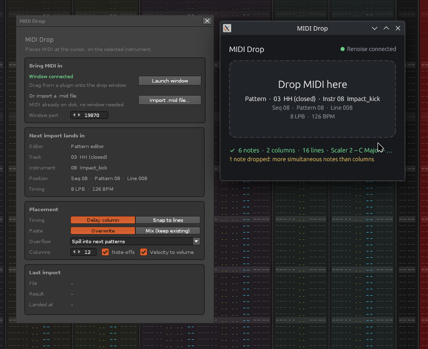

# MIDI Drop

Drag MIDI out of a plugin. Drop it on Renoise. It lands right where your
cursor is, on the instrument you have selected.



Lots of plugins can drag MIDI out: chord tools, drum machines, arpeggiators,
groove libraries. Renoise accepts those drops, but it treats every drop like a
whole MIDI song. It makes a new instrument and a new track, and adds a new
pattern at the very end of your song. Then you copy the notes to where you
wanted them, and clean up the mess.

MIDI Drop skips all of that. The notes go to the cursor, in the pattern
editor or in the phrase editor. One *Undo* takes the whole drop back.

This started as a request on the Renoise forum:
[tool request](https://forum.renoise.com/t/tool-request-drag-and-drop-midi-to-renoise-from-a-plugin/79721) and
[improve MIDI drag and drop](https://forum.renoise.com/t/improve-midi-drag-and-drop-support-from-plugins/76797).

## What you get

MIDI Drop comes in two parts that work together:

- **The tool** (`com.dac514.MidiDrop.xrnx`), which lives inside Renoise. It
  reads the MIDI and writes the notes into your song. Its window, the
  *monitor*, shows where the next drop will land, plus the options.
- **The drop window** (`midi-drop`), a small window that stays on top of
  everything. You drop MIDI on it, and it passes the MIDI to the tool. It
  opens where you left it last time, at the same size.

Why two parts? The short answer is that Renoise does not let a tool catch a
drop by itself. The long answer is [further down](#why-a-second-window).

No drop window at hand, or the MIDI is already a file? Click
**Import .mid file...** in the monitor. Same result, no drop needed.

## Install

1. Download the files for your computer from the
   [latest release](https://github.com/dac514/mididrop/releases/latest):
   - everyone: `com.dac514.MidiDrop.xrnx`
   - Windows: `midi-drop-windows-x86_64.zip`
   - macOS (Apple Silicon and Intel): `midi-drop-macos-universal.zip`
   - Linux: `midi-drop-linux-x86_64.tar.gz`
2. Drag `com.dac514.MidiDrop.xrnx` onto Renoise to install the tool.
3. Unpack the drop window somewhere you like. On macOS, move `MIDI Drop.app`
   to *Applications*.
4. Open the drop window once, by double-clicking it. MIDI Drop remembers
   where it is. From then on, *Tools > MIDI Drop...* > **Launch window** in
   Renoise starts it for you.

Clicked **Launch window** before you had the drop window? MIDI Drop shows you
which file to download, with a button to the download page.

The drop window is not signed with a paid certificate, so your computer may
warn you the first time:

- **macOS**: right-click `MIDI Drop.app` and choose *Open*, then *Open* again.
  You only do this once.
- **Windows**: if SmartScreen appears, click *More info*, then *Run anyway*.

## Use it

1. Put the Renoise cursor where the clip should start: a track and a line in
   the pattern editor, or a line in the phrase editor.
2. Drag MIDI from your plugin onto the drop window. Before you let go, the
   window tells you where the notes will land. After, it tells you what
   happened.
3. Not what you wanted? Press *Undo* in Renoise once.

The drop window opens where you left it last time. Can't find it, for
example after you unplugged a screen? Choose *Tools > Find MIDI Drop Window*.
The window comes back to the top left of your main screen. You can give it a
key: *Global > Tools > Find MIDI Drop Window*.

A few things work the way a tracker user would hope:

- **Timing follows the beat, not the clock.** A quarter note is always LPB
  lines, so the BPM does not matter. Notes between lines keep their exact
  timing in the delay column, or you can snap them to lines.
- **Chords spread out** over note columns (up to 12).
- **Long clips keep going.** If a clip is longer than the pattern, it spills
  into the next patterns. You can also grow the pattern, or cut the clip.
- **Phrases use their own LPB**, and grow to fit (up to 512 lines).
- **Notes match Renoise.** MIDI note 60 becomes C-5, the same as Renoise's
  own MIDI import.

All options are explained in the [tool's README](com.dac514.MidiDrop.xrnx/README.md).

## Why a second window?

We tried hard to make the tool do everything by itself. Here is what we found
in Renoise 3.5 (API 6.2):

- A tool **can** ask Renoise for every `.mid` file that is dropped on it.
  That is what `add_file_import_hook` is for. But for MIDI files, Renoise only
  offers this as a *song* import. So before the tool gets the file, Renoise
  asks you to save, closes your song, and opens a new empty one. Not great
  when you only wanted four bars of hi-hats.
- A tool's own window can show buttons, text and sliders, but it **cannot
  receive a dropped file**. There is no "drop" event in Renoise's ViewBuilder.

So the drop has to land somewhere outside Renoise. The drop window catches it,
reads the file at once (plugins delete their temporary files as soon as the
drag ends), and sends the bytes to the tool over `127.0.0.1`, port 19870. The
tool does the real work inside Renoise.

## Why Rust?

The drop window has a small job, but it has to do it well on three operating
systems. Rust (with the [egui](https://github.com/emilk/egui) toolkit) gave us:

- **One small file per system.** A few megabytes. Nothing else to install: no
  Python, no Java, no 150 MB browser engine.
- **Real file drops everywhere.** Windows, macOS and Linux each have their own
  drag and drop system. egui handles all three, so the code is the same.
- **It starts fast and stays light**, which matters for a window that sits on
  top of your plugins all day.
- **GitHub builds it for us.** Every release builds the Windows, macOS and
  Linux versions automatically, so nobody needs three computers.

We did look at Python first. Its built-in toolkit cannot accept file drops
without extra libraries, and shipping Python to music makers on Windows and
macOS is no fun at all.

## What Renoise could add, so we can delete the second window

The drop window only exists because of two gaps in the Renoise API. If either
one gets fixed, MIDI Drop can become a normal tool with nothing extra to
install.

1. **Let file import hooks keep the current song.** Today, a hook for `.mid`
   only works as a song import, and Renoise closes your song first. We would
   love a way to import into the song that is already open. That could be a
   new category (for example `"pattern"` or `"midi clip"`), or an option on
   the hook. Even better: tell the hook *where* the file was dropped (which
   track and line).
2. **Let tool windows receive drops.** A drop target in ViewBuilder, for
   example `vb:drop_area { notifier = function(paths) ... end }`, would let
   the monitor itself be the drop zone.

And one small fix that would have saved us a bug hunt:

3. **Don't pass Renoise's sockets to programs a tool starts.** When a tool
   runs a program with `os.execute`, that program gets a copy of every network
   socket Renoise has open, including the tool's own. Then the tool cannot
   open its port again until the program quits. (The drop window now closes
   these copies at startup, so you don't need to worry.) Marking the sockets
   "close on exec" inside Renoise would fix this for every tool.

Of course, the best fix of all would be for Renoise's own MIDI drop to land at
the cursor. Then nobody needs a tool. Until that day, there is MIDI Drop.

## Work on MIDI Drop

Want to make it better? Great. The project is set up so that you, or a coding
assistant like [Claude Code](https://claude.com/claude-code), can build, test
and reload everything from the command line while Renoise is running.
[`CLAUDE.md`](CLAUDE.md) is the full briefing. It is written for assistants,
but people can read it too.

**Most users are on Windows and macOS, and that is where help is most
welcome.** MIDI Drop was built and tested on Linux. Open items:

- Test a real drag from a plugin on Windows and on macOS. (On Linux it was
  tested with drags from a file manager, which works the same way.)
- Test *Launch window* on Windows (it uses PowerShell's `Start-Process`) and
  on macOS (it uses `open` with the `.app`).
- Check plugins that drag in unusual ways. For example, macOS can drag a
  "file promise" instead of a real file. The drop window does not support
  that yet.

### What you need

- [Renoise](https://www.renoise.com) 3.5 or newer, with its OSC server on:
  *Edit > Preferences > OSC > Enable Server*, UDP, port 8000.
- [Rust](https://rustup.rs) 1.88 or newer, for the drop window.
- Python 3.8 or newer, [just](https://github.com/casey/just),
  [StyLua](https://github.com/JohnnyMorganz/StyLua),
  [lua-language-server](https://github.com/LuaLS/lua-language-server) and
  [LuaJIT](https://luajit.org), for the tool.

Not sure what is missing? Run `just doctor` (or `python3 scripts/renoise.py doctor`).
It tells you, with install hints for your system.

- macOS: `brew install just stylua lua-language-server luajit`
- Windows: `winget install Casey.Just JohnnyMorganz.StyLua LuaLS.lua-language-server Python.Python.3.13`,
  plus `scoop install luajit`
- Linux: `just` and `luajit` from your package manager, StyLua and
  lua-language-server from their GitHub releases

### Everyday commands

```
just install        # put the tool into Renoise (once)
just check          # format and type check the Lua
just test           # unit tests, no Renoise needed
just reload         # reload the tool in Renoise, in about a second
just eval 'APP.show_dialog()'
just views          # what the monitor shows, as text
just log            # prints and errors from inside the tool
just dropper-run    # build and start the drop window
just dropper-test   # unit tests of the drop window
just package        # dist/com.dac514.MidiDrop.xrnx, ready to share
```

To test without a plugin, drag any `.mid` file from your file manager onto the
drop window, or start it with a file: `just dropper-run -- path/to/clip.mid`.

### Where things are

```
com.dac514.MidiDrop.xrnx/    the Renoise tool
  src/smf.lua                reads MIDI files (pure Lua, unit tested)
  src/place.lua              turns notes into pattern cells (pure, unit tested)
  src/text.lua               all text in the monitor (pure, unit tested)
  src/wire.lua               the message format shared with the drop window
  src/target.lua             works out where the next drop lands
  src/writer.lua             writes the notes into the song
  src/server.lua             listens for the drop window on 127.0.0.1
  src/app.lua, src/ui.lua    menus, the monitor, starting the drop window
  dev/                       a dev bridge for the command line (never shipped)
dropper/                     the drop window (Rust)
tests/                       Lua unit tests (`just test`)
scripts/renoise.py           all the chores behind `just`
definitions/, docs/renoise/  the Renoise API and guide, for editors and assistants
```

### Making a release

Set `<Version>` in `com.dac514.MidiDrop.xrnx/manifest.xml` (like `1.01`), then
push a tag with the same number: `git tag v1.01 && git push origin v1.01`.
GitHub builds the tool and all three drop windows and attaches them to the
release.

## Credits and license

MIT. Made by Dac Chartrand.

The MIDI reader started from the `Midi` class in
[MidiConvert](https://www.renoise.com/tools/midi-convert), which grew out of
Valentin Schmidt's PHP MIDI class. The project is built on the
[ReSlop](https://github.com/dac514/reslop) starter kit, and includes the
MIT-licensed [renoise/definitions](https://github.com/renoise/definitions) and
guide pages from [renoise/xrnx](https://github.com/renoise/xrnx) (see the
`UPSTREAM.md` files).
